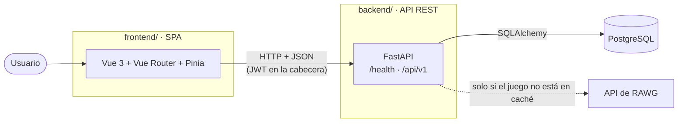
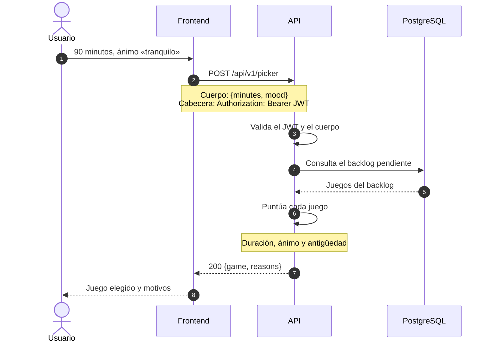
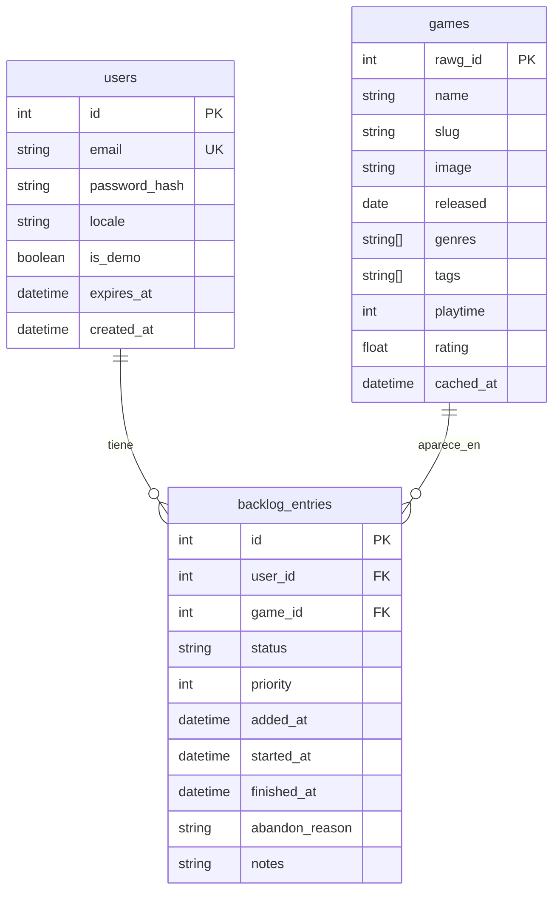
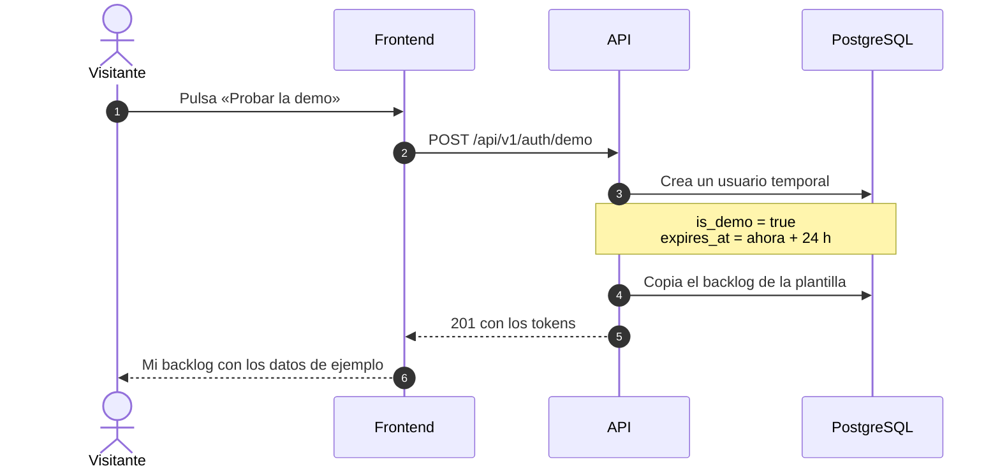

# Arquitectura

Visión técnica de Backlog to Play: qué piezas lo forman, cómo se comunican y por qué están organizadas así.

> Este documento distingue lo **implementado** de lo **planificado**. Cuando una pieza planificada se implemente, se actualiza aquí en el mismo Pull Request.

## Visión general



| Pieza          | Responsabilidad                                                   | Estado                                         |
| -------------- | ----------------------------------------------------------------- | ---------------------------------------------- |
| **Frontend**   | Interfaz, navegación y estado de la sesión en el navegador        | Esqueleto con router y Pinia                   |
| **API**        | Reglas de negocio, autenticación, caché de RAWG y recomendaciones | Esqueleto con configuración, CORS y `/health`  |
| **PostgreSQL** | Usuarios, backlog y copia en caché de los juegos                  | Contenedor local en Docker, sin tablas todavía |
| **RAWG**       | Catálogo externo de videojuegos                                   | Planificado (Sprint 2)                         |

## Principios

1. **Frontend y backend son independientes.** Cada uno tiene sus dependencias, su `.env` y su ciclo de tests. Solo se comunican por HTTP y nunca comparten código. Se pueden desplegar, probar y sustituir por separado.
2. **La lógica de negocio vive en el backend.** El frontend muestra datos y recoge acciones; decidir qué juego recomendar o quién puede ver un backlog es responsabilidad de la API.
3. **Configuración por entorno, fallo temprano.** Los valores que cambian entre entornos se leen de variables de entorno y no tienen valor por defecto. Si falta alguno, la aplicación no arranca.
4. **Recomendaciones deterministas y explicables.** «Elígeme uno» y las recomendaciones se calculan con reglas y similitud de conjuntos, sin LLM. El mismo backlog con la misma entrada da el mismo resultado, y cada resultado lleva sus motivos ([ADR-9](adr/0009-recomendaciones-sin-llm.md)).
5. **RAWG es una fuente, no una dependencia en tiempo real.** Cada juego consultado se guarda en la base de datos propia; RAWG solo se llama cuando el juego no está en caché.

## Backend

```
backend/app/
├── main.py              Crea la app, añade CORS, define /health y monta /api/v1
├── core/
│   └── config.py        Settings: configuración leída de variables de entorno
└── api/v1/
    └── router.py        api_router: agrupa los routers de cada recurso
```

### Decisiones de diseño

- **Versionado en la URL (`/api/v1`).** Un cambio incompatible en el futuro se publicaría como `/api/v2` sin romper a los clientes existentes.
- **`/health` fuera de la versión.** Es una comprobación de infraestructura (¿está viva la API?), no una funcionalidad de negocio, y su contrato no debe cambiar con las versiones.
- **Un router por recurso.** Cada recurso (`auth`, `games`, `backlog`…) tendrá su propio `APIRouter` en `app/api/v1/` y se registrará en `router.py`. `main.py` no crece al añadir funcionalidades.
- **Configuración centralizada.** `Settings` (pydantic-settings) valida los tipos al arrancar: `CORS_ORIGINS` se convierte en `list[str]` y un valor mal formado detiene el arranque.
- **CORS restringido.** Solo los orígenes de `CORS_ORIGINS` pueden llamar a la API desde un navegador; nunca `*`.

### Capas planificadas

Al crecer, el backend se organizará en capas con responsabilidades separadas:

| Carpeta     | Responsabilidad                                                             |
| ----------- | --------------------------------------------------------------------------- |
| `api/v1/`   | Rutas HTTP: validan la entrada, llaman al servicio y devuelven la respuesta |
| `schemas/`  | Modelos Pydantic de entrada y salida (el contrato de la API)                |
| `services/` | Lógica de negocio: caché de RAWG, «Elígeme uno», recomendaciones            |
| `models/`   | Modelos de SQLAlchemy (las tablas)                                          |
| `db/`       | Sesión de base de datos y dependencias de FastAPI                           |
| `alembic/`  | Migraciones del esquema                                                     |

Las rutas no hablan con la base de datos directamente: delegan en los servicios. Así la lógica de negocio se puede probar sin levantar un servidor HTTP.

## Frontend

```
frontend/src/
├── main.ts              Crea la app y registra Pinia y el router
├── App.vue              Marco común: navegación y <RouterView />
├── router/index.ts      Tabla de rutas
├── views/               Páginas completas, una por ruta
├── components/          Piezas reutilizables
├── stores/              Estado compartido (Pinia)
└── assets/              Estilos globales
```

| Concepto                       | Uso en el proyecto                                                                                                    |
| ------------------------------ | --------------------------------------------------------------------------------------------------------------------- |
| **Vista** (`views/`)           | Una página asociada a una ruta: `HomeView`, y más adelante `BacklogView`, `GameView`…                                 |
| **Componente** (`components/`) | Una pieza reutilizable dentro de las vistas: una tarjeta de juego, un selector de estado                              |
| **Store** (`stores/`)          | Estado compartido entre vistas: la sesión del usuario, el backlog cargado                                             |
| **Router**                     | Relaciona cada URL con una vista. Las vistas que no son la de inicio se cargarán bajo demanda con `() => import(...)` |

Pinia se registra antes que el router porque los _guards_ de navegación (por ejemplo, «esta ruta exige sesión») consultarán el store de autenticación.

## Flujo de una petición: «Elígeme uno»

Ejemplo del flujo previsto para la funcionalidad central:



La puntuación de cada juego del backlog suma el encaje de su duración con el tiempo disponible, el encaje de géneros y etiquetas con el ánimo y un bonus por antigüedad en el backlog, y resta una penalización si el usuario lo descartó hace poco.

## Modelo de datos

Borrador. El esquema definitivo se fijará con las migraciones de Alembic.



- `games` es la **caché de RAWG**: `cached_at` permite decidir cuándo refrescar un juego.
- `backlog_entries.status` admite `pending`, `playing`, `finished` y `abandoned`.
- La combinación `user_id` + `game_id` es única: un juego no puede estar dos veces en el mismo backlog (la API responde `409`).
- `users.is_demo` y `users.expires_at` identifican las cuentas demo temporales (ver [Demo para visitantes](#demo-para-visitantes)). En los usuarios reales, `is_demo` es `false` y `expires_at` es nulo.

## Demo para visitantes

Planificada para el Sprint 6 ([ADR-14](adr/0014-demo-por-visitante.md)). La demo es una forma de entrar en la misma web, no un despliegue aparte:



- Cada visitante tiene su propia cuenta, así que nunca ve lo que otro ha cambiado o borrado.
- La plantilla es la misma función que llena la base de datos local en desarrollo.
- La tarea diaria de Vercel borra las cuentas demo caducadas.
- Hay un límite de cuentas por IP y de búsquedas en RAWG por cuenta demo; si se supera, la API responde `429`.

## Seguridad

| Aspecto             | Medida                                              | Estado                 |
| ------------------- | --------------------------------------------------- | ---------------------- |
| Secretos            | Solo en variables de entorno; `.env` fuera de Git   | Implementado           |
| CORS                | Lista blanca de orígenes desde la configuración     | Implementado           |
| Base de datos local | Puerto publicado solo en `127.0.0.1`                | Implementado           |
| Contraseñas         | Hash con argon2 o bcrypt; nunca se guardan en claro | Planificado (Sprint 1) |
| Autenticación       | JWT de acceso de corta duración y token de refresco | Planificado (Sprint 1) |

## Despliegue

Planificado para el Sprint 6 ([ADR-11](adr/0011-despliegue-en-vercel.md) y [ADR-6](adr/0006-postgresql-en-supabase.md)):

| Pieza         | Destino                                                     |
| ------------- | ----------------------------------------------------------- |
| Frontend      | Vercel (sitio estático)                                     |
| API           | Vercel (funciones serverless de Python)                     |
| Base de datos | PostgreSQL en Supabase, a través del _pooler_ de conexiones |

En serverless cada invocación puede abrir conexiones nuevas, así que la API usará el pooler de Supabase para no agotar el límite de conexiones del plan gratuito.

## Pendiente de decidir

- **Identidad visual** ([ADR-12](adr/0012-identidad-visual-propia.md), en estado _Propuesta_): se cerrará con el moodboard del Sprint 0.
